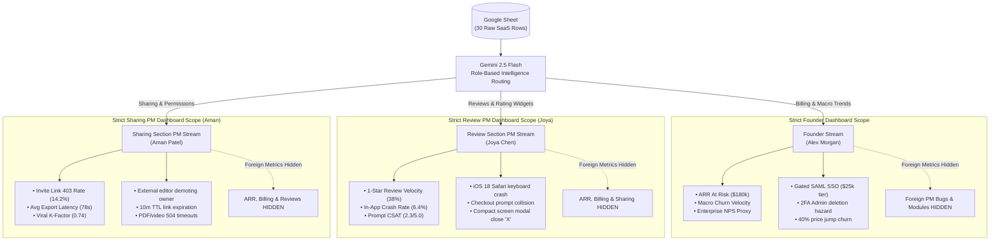

# Laser AI — System Architecture Specification (v2.2)

## 1. Executive Summary

**Laser AI** is an automated SaaS customer feedback intelligence platform designed for Founders and Feature Product Managers. It transforms raw, unstructured customer feedback from a pre-connected 30-row Google Sheet dataset (covering *Reviews/Ratings*, *Sharing/Permissions*, and *Billing/Macro Trends*) into role-segregated executive product digests using the **Google Gemini 2.5 Flash API** (`gemini-2.5-flash`), featuring a **5-screen light-theme SaaS workspace** and real-time multi-channel delivery to **Slack Webhooks** and **Gmail / Resend**.

---

## 2. Strict Single-Role Isolation Architecture

Laser AI strictly enforces role-based boundaries. When logged in under a specific persona, the user operates in complete isolation from other personas with zero cross-role clutter:

---

## 3. Light-Mode SaaS Design System (Linear / Notion Inspired)

- **Canvas**: Pure off-white/slate-50 canvas (`#F8FAFC`).
- **Cards**: Crisp white containers (`#FFFFFF`) with soft shadow (`shadow-xs` / `shadow-sm`).
- **Borders**: Subdued borders (`#E2E8F0`, `border-slate-200`) providing visual grouping without heaviness.
- **Typography**: High-contrast slate-900 typography (`#0F172A`) paired with balanced slate-500 secondary labels.
- **Accents**: 
  - Indigo (`#4F46E5`): Primary actions and brand accents.
  - Emerald (`#10B981`): Positive sentiment and successful dispatch alerts.
  - Amber (`#F59E0B`): Neutral sentiment and caution indicators.
  - Rose (`#F43F5E`): Urgent bugs, revenue risk, and negative sentiment.

---

## 4. 5-Screen User Flow

1. **Screen 1 — Interactive Marketing Page**:
   - Playable visual canvas demonstrating feedback traveling from Google Sheets through Gemini 2.5 Flash into role digests.
   - Interactive sample pill tester (*"Pricing doubled"*, *"Rating popup during checkout"*, *"Invite link 403"*) with real-time routing signals.
   - "See Example Digests" comparison modal for Founder vs. Feature PMs.
   - 1-click persona quick starts: "Launch as Founder", "Launch as Joya (Review PM)", "Launch as Aman (Sharing PM)".
2. **Screen 2 — Demo Login**:
   - Clean, light card with 1-click **"Continue with Google (Demo)"** bypass login.
3. **Screen 3 — Onboarding & Routing Form**:
   - Captures `Name`, `Email`, optional `Slack Webhook URL`, `Digest Frequency`, and `User Role`.
4. **Screen 4 — Strictly Isolated Role Dashboard**:
   - Dedicated workspace strictly scoped to the user's role (Founder, Review PM, or Sharing PM).
   - "Switch Role / Re-configure" header button to return cleanly to Onboarding if testing another identity.
   - Dynamic charts, metrics, bug trackers, and feature requests strictly scoped to the active persona.
   - Raw Feedback Modal with scoped vs. all rows toggle.
5. **Screen 5 — Digest Preview & Instant Dispatch**:
   - Unified live Email HTML and Slack Block Kit preview matching the active role's dashboard.
   - Primary **"Send Digest Now"** action button with instant live delivery feedback.
